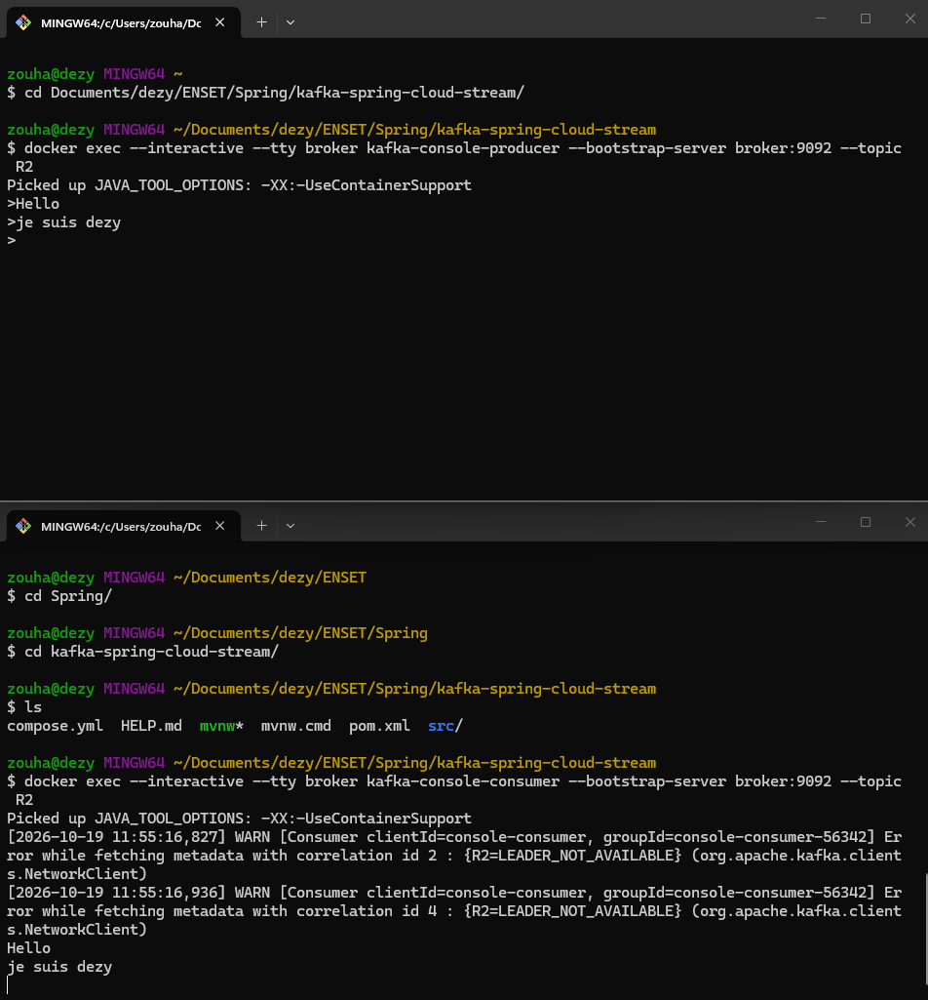
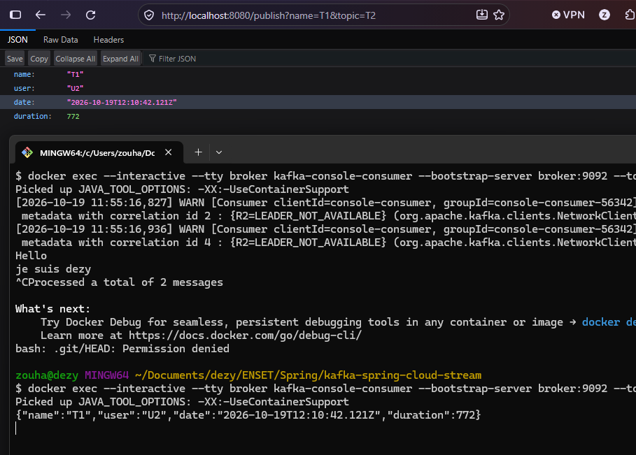
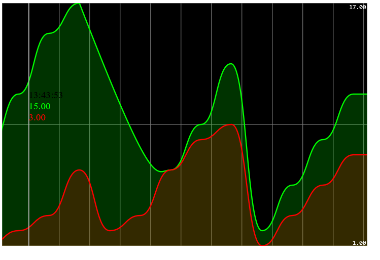

# kafka-spring-cloud-stream

---

## Table des matières

1. [Présentation](#présentation)
2. [Architecture](#architecture)
3. [Structure du projet](#structure-du-projet)
4. [Description des composants](#description-des-composants)
5. [Configuration](#configuration)
6. [Tests et résultats](#tests-et-résultats)
7. [Auteur](#auteur)

---

## Présentation

Le projet illustre les différentes façons de produire, consommer et analyser des flux de données avec Kafka :

| Étape | Mécanisme | Description |
|---|---|---|
| 1 | Console Kafka | Test du broker avec `kafka-console-producer` et `kafka-console-consumer` |
| 2 | `StreamBridge` + `Consumer` | Publication d'un événement via une API REST, réception par un consommateur Spring Cloud Stream |
| 3 | `Supplier` | Génération automatique d'événements toutes les 200 ms |
| 4 | `Function<KStream, KStream>` | Traitement en flux avec Kafka Streams (filtrage, regroupement, comptage par fenêtre) |
| 5 | SSE + Smoothie Charts | Affichage temps réel des résultats sous forme de courbes |

|

---

## Architecture


### Flux de données

1. **`pageEventSupplier`** génère un `PageEvent` aléatoire toutes les 200 ms et l'envoie dans le topic `T3`.
2. **`kStream`** lit `T3`, ne garde que les événements dont la durée dépasse 100, les regroupe par nom de page, les compte dans des fenêtres de 5 secondes (store `count-store`) et écrit les résultats dans `T7`.
3. **`/analytics`** interroge le store `count-store` chaque seconde (via `InteractiveQueryService`) et diffuse le résultat en **Server-Sent Events**.
4. **`index.html`** reçoit ce flux et trace une courbe par page (`P1` en vert, `P2` en rouge).
5. En parallèle, **`/publish`** permet d'envoyer manuellement un événement vers n'importe quel topic, et **`pageEventConsumer`** affiche en console les événements reçus sur `T1`.

---

## Structure du projet

```
kafka-spring-cloud-stream/
├── compose.yml                          # Zookeeper + broker Kafka
├── pom.xml
├── mvnw / mvnw.cmd                      # Maven Wrapper
└── src/
    ├── main/
    │   ├── java/com/zouhari/kafkaspringcloudstream/
    │   │   ├── KafkaSpringCloudStreamApplication.java
    │   │   ├── events/
    │   │   │   └── PageEvent.java       # Événement (record)
    │   │   ├── handlers/
    │   │   │   └── PageEventHandler.java    # Consumer, Supplier, KStream
    │   │   └── controllers/
    │   │       └── PageEventController.java # /publish et /analytics
    │   └── resources/
    │       ├── application.properties   # Bindings Spring Cloud Stream
    │       └── static/
    │           └── index.html           # Page de visualisation
    └── test/
        └── java/.../KafkaSpringCloudStreamApplicationTests.java
```

---

## Description des composants

### `PageEvent`

Record Java représentant une consultation de page :

```java
public record PageEvent(String name, String user, Date date, long duration) {}
```

| Champ | Description |
|---|---|
| `name` | Nom de la page |
| `user` | Utilisateur (`U1` ou `U2`) |
| `date` | Date de l'événement |
| `duration` | Durée de consultation |

### `PageEventHandler`

Déclare trois beans fonctionnels, activés dans `application.properties` :

| Bean | Type | Rôle |
|---|---|---|
| `pageEventConsumer` | `Consumer<PageEvent>` | Lit le topic `T1` et affiche chaque événement entre deux lignes d'étoiles |
| `pageEventSupplier` | `Supplier<PageEvent>` | Produit un événement aléatoire (page `P1`/`P2`, utilisateur `U1`/`U2`, durée de 10 à 10009) toutes les 200 ms vers `T3` |
| `kStream` | `Function<KStream<String, PageEvent>, KStream<String, Long>>` | Traitement Kafka Streams de `T3` vers `T7` |

Pipeline Kafka Streams :

```java
input
    .filter((k, v) -> v.duration() > 100)
    .map((k, v) -> new KeyValue<>(v.name(), 0L))
    .groupByKey(Grouped.with(Serdes.String(), Serdes.Long()))
    .windowedBy(TimeWindows.ofSizeWithNoGrace(Duration.ofSeconds(5)))
    .count(Materialized.as("count-store"))
    .toStream()
    .map((k, v) -> new KeyValue<>(k.key(), v));
```

### `PageEventController`

| Endpoint | Description |
|---|---|
| `GET /publish?name=...&topic=...` | Crée un `PageEvent` (utilisateur et durée aléatoires), l'envoie dans le topic indiqué avec `StreamBridge` et le renvoie en JSON |
| `GET /analytics` | Flux **SSE** : toutes les secondes, renvoie le nombre d'événements par page sur les 5 dernières secondes, lu dans `count-store` |

### `index.html`

Page statique servie à `http://localhost:8080/index.html`. Elle s'abonne à `/analytics` avec `EventSource` et alimente deux `TimeSeries` Smoothie Charts (une par page : `P1` vert, `P2` rouge).

---

## Configuration

`application.properties` :

```properties
spring.application.name=kafka-spring-cloud-stream

# Consumer : lit T1
spring.cloud.stream.bindings.pageEventConsumer-in-0.destination=T1

# Supplier : écrit dans T3 toutes les 200 ms
spring.cloud.stream.bindings.pageEventSupplier-out-0.destination=T3
spring.cloud.stream.bindings.pageEventSupplier-out-0.producer.poller.fixed-delay=200

# Kafka Streams : T3 -> T7
spring.cloud.stream.bindings.kStream-in-0.destination=T3
spring.cloud.stream.bindings.kStream-out-0.destination=T7

spring.cloud.function.definition=pageEventConsumer;pageEventSupplier; kStream
spring.cloud.stream.kafka.streams.binder.configuration.commit.interval.ms=1000
```

### Docker Compose

| Service | Image | Port |
|---|---|---|
| `zookeeper` | `confluentinc/cp-zookeeper:7.3.0` | 2181 |
| `broker` | `confluentinc/cp-kafka:7.3.0` | 9092 (externe), 29092 (interne) |

Le broker annonce `localhost:9092` aux clients de l'hôte (l'application Spring) et `broker:29092` aux clients internes à Docker.

---


### 4. Utiliser l'application

| Action | URL / commande |
|---|---|
| Visualiser les courbes | http://localhost:8080/index.html |
| Voir le flux SSE brut | http://localhost:8080/analytics |
| Publier un événement | http://localhost:8080/publish?name=P1&topic=T1 |

---

## Tests et résultats

### 1. Test du broker avec les consoles Kafka

Producteur et consommateur lancés dans le conteneur `broker`, sur le topic `R2` :

```bash
# Terminal 1 : producteur
docker exec --interactive --tty broker kafka-console-producer \
    --bootstrap-server broker:9092 --topic R2

# Terminal 2 : consommateur
docker exec --interactive --tty broker kafka-console-consumer \
    --bootstrap-server broker:9092 --topic R2
```

Les messages `Hello` et `je suis dezy` saisis dans le producteur apparaissent dans le consommateur.



> Les avertissements `LEADER_NOT_AVAILABLE` au premier lancement sont normaux : le topic est créé automatiquement à la première utilisation et le leader n'est pas encore élu.

### 2. Publication via l'API REST

Appel de `http://localhost:8080/publish?name=T1&topic=T2` : l'API renvoie l'événement en JSON, et le même message est reçu par un consommateur console abonné au topic `T2`.



> L'application n'écoute que `T1` (`pageEventConsumer-in-0`). Pour voir l'événement affiché par l'application elle-même, utiliser `topic=T1`.

### 3. Courbes en temps réel

`index.html` affiche, pour chaque page, le nombre d'événements comptés sur la fenêtre courante : `P1` en vert, `P2` en rouge. L'infobulle indique les valeurs à l'instant survolé (ici 15 et 3).



---

## Auteur

**ZOUHARI Dyae Errahmane** --- [GitHub](https://github.com/zouharidyaeerrahmane)